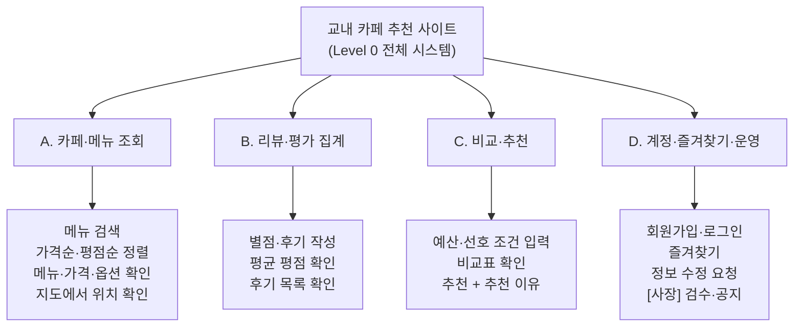
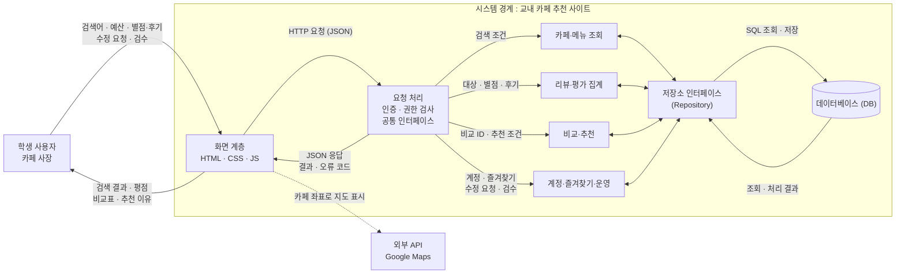

# 기창공 9조 (교내 카페 추천 사이트)

> 기창공 9조 조별과제 — 교내 카페의 메뉴·가격·평점을 한곳에서 찾아보고, 예산과 취향에 맞는 메뉴를 비교·추천받는 웹 서비스
 
## 프로젝트 소개
 
교내에 카페는 여러 곳 있지만, 어느 카페에 어떤 메뉴가 얼마인지, 어디가 맛있는지 한눈에 비교하기 어렵습니다.
이 사이트는 교내 카페 정보를 모아 **검색 → 평가 확인 → 비교·추천**까지 한 흐름으로 제공합니다.
 
**사용자**
 
| 사용자 | 설명 |
| --- | --- |
| 학생 사용자 | 메뉴 검색, 별점·후기 작성, 비교·추천, 즐겨찾기, 메뉴·가격 정보 수정 요청 |
| 카페 사장 | 학생이 보낸 수정 요청 검수 후 반영, 카페 공지사항 등록·수정 |
 
## 주요 기능
 
전체 시스템을 4개의 하위 시스템으로 나누었습니다.
 
### A. 카페·메뉴 조회
카페·메뉴 정보를 찾아보는 기능
- 메뉴명·카테고리로 메뉴 검색
- 가격순·평점순 정렬
- 카페별 메뉴·가격·옵션 확인
- 지도에서 카페 위치 확인 (Google Maps)
### B. 리뷰·평가 집계
별점·후기를 남기고 확인하는 기능
- 별점과 짧은 후기 작성 (로그인 사용자)
- 카페·메뉴별 평균 평점 확인
- 다른 사용자의 후기 목록 확인
### C. 비교·추천
조건에 맞는 메뉴를 비교·추천하는 기능
- 예산·선호 조건 입력
- 카페·메뉴 비교표 확인
- 조건에 맞는 메뉴 추천과 추천 이유 확인
### D. 계정·즐겨찾기·운영
회원 관리와 카페 정보 운영 기능
- 회원가입·로그인
- 즐겨찾기 등록·해제
- 메뉴·가격 정보 수정 요청
- **[카페 사장]** 수정 요청 검수 후 반영
- **[카페 사장]** 카페 공지사항 등록·수정

## 문제 상세 분해
 

## 시스템 구조 (블록 다이어그램)
 

 
### 계층별 역할
 
| 계층 | 역할 | 주고받는 데이터 |
| --- | --- | --- |
| **화면 계층** (HTML · CSS · JS) | 사용자 입력을 받고 결과를 보여 줌 | 입력: 검색어, 예산, 별점·후기, 수정 요청, 검수 처리 출력: 검색 결과·평점, 비교표, 추천 이유 |
| **요청 처리 계층** | 요청 처리, 인증, 권한 검사, 공통 인터페이스 | 요청: HTTP 요청(JSON) — 검색 조건, 대상 ID, 입력값 응답: JSON — 결과, 오류 코드 |
| **기능 모듈** | 4개 하위 시스템의 실제 로직 | 아래 표 참고 |
| **저장소 인터페이스** (Repository) | 기능 모듈과 DB 사이의 데이터 접근 창구 | SQL 조회·저장 / 조회·처리 결과 |
| **데이터베이스** | 서비스 데이터 저장 | 아래 데이터 구성 참고 |
| **외부 서비스** (카카오맵) | 카페 좌표로 지도 링크 제공 | 카페 위치 좌표 |
 
### 기능 모듈 입출력
 
| 모듈 | 입력 (요청 처리 → 모듈) | 저장소 작업 (모듈 ↔ Repository) |
| --- | --- | --- |
| 카페·메뉴 조회 | 검색 조건 | 카페·메뉴·옵션 조회 |
| 리뷰·평가 집계 | 대상, 별점, 후기 | 리뷰 저장, 집계 |
| 비교·추천 | 비교 ID, 추천 조건 | 후보, 평가 조회 |
| 계정·즐겨찾기·운영 | 계정, 즐겨찾기, 수정 요청·검수 | 계정, 즐겨찾기, 요청·공지 저장 |
 

## 데이터 구성
 
DB에 저장하는 데이터입니다.
 
- **카페** (위치 좌표 포함)
- **메뉴·옵션**
- **리뷰**
- **계정**
- **즐겨찾기**
- **수정 요청**
- **공지**

## 기술 스택
 
| 구분 | 사용 기술 |
| --- | --- |
| 화면 | HTML, CSS, JavaScript |
| 통신 | HTTP + JSON |
| 데이터 접근 | Repository 패턴, SQL |
| 외부 연동 | 카카오맵 링크 |
 
## 팀 구성
 
| 팀원 | 역할 | 주요 업무 |
| --- | --- | --- |
| 김민성 | 발표자료 제작, 화면 설계·사용성 테스트 | 문제 분해·블록 다이어그램 시각화, 발표자료 제작, UI 검수, 시연 흐름 정리 |
| 남성준 | 팀장, UI 구현 | 일정·진행 관리, 공통 디자인, 화면 배치, 페이지 이동, 반응형 화면 구현 |
| 박찬민 | 발표, 기능 구현 | 검색·비교·추천·평점 기능 구현, 데이터 저장 처리, 발표 대본·발표 |
| 왕몽소 | 자료조사, 조사 결과 인계 | 교내 카페·메뉴·가격 조사, 유사 서비스 분석, 참고자료·출처 정리 |
| 한영현 | 보고서 제작, 기능 명세·기능 테스트 | 상세 기능 설계서, 데이터·알고리즘 설명, 테스트 수행·결과 정리, 최종 보고서 작성 |
 
## 🔗 참고 자료
 
- 설계 도표 (FigJam): [기창공 9조](https://www.figma.com/board/m9s9sSBcNoIEaX6fzojD1s)
